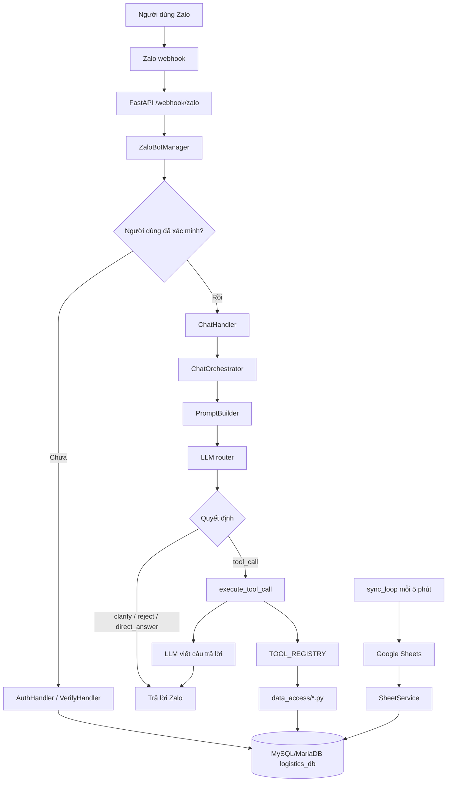

# HPL Chatbot

HPL Chatbot là chatbot nội bộ cho Hòa Phát Logistics. Hệ thống nhận tin nhắn từ Zalo, kiểm tra quyền người dùng, dùng LLM để hiểu câu hỏi nghiệp vụ, gọi các hàm tra cứu dữ liệu trong MySQL/MariaDB, rồi trả lời lại người dùng bằng tiếng Việt.

## 1. Chức năng chính

- Nhận và trả lời tin nhắn Zalo qua webhook `/webhook/zalo`.
- Xác minh người dùng bằng `user_id` và `invite_key` trước khi cho chat.
- Tự đồng bộ dữ liệu Google Sheets vào database `logistics_db` mỗi 5 phút.
- Tra cứu thông tin xe, rơ mooc, đăng kiểm, bảo hiểm, giấy ngân hàng, phù hiệu, camera.
- Tra cứu ghép xe - rơ mooc - container - lái xe.
- Tra cứu kế hoạch đăng kiểm, kế hoạch bảo dưỡng sửa chữa, lịch sử BDSC, thay dầu.
- Dùng LLM theo 2 bước: bước 1 chọn tool cần gọi, bước 2 viết câu trả lời cuối cho người dùng.

## 2. Sơ đồ tổng quan



## 3. Cấu trúc thư mục

```text
hpl_chatbot/
|-- app.py                     # Điểm chạy chính: set webhook, chạy FastAPI, sync định kỳ
|-- run_bot.bat                # Script Windows để mở ngrok và chạy app.py
|-- sync_data.py               # Danh sách các sheet cần đồng bộ
|-- config/
|   `-- config.py              # Đọc biến môi trường từ .env
|-- database/
|   `-- db_connect.py          # Kết nối MySQL/MariaDB logistics_db
|-- zalo/
|   |-- sender.py              # FastAPI app, route /webhook/zalo, route /health
|   `-- set_webhook.py         # Gọi Zalo API để set webhook
|-- handlers/
|   |-- auth_handler.py        # Xử lý /start
|   |-- verify_handler.py      # Xác minh user_id + invite_key
|   `-- chat_handler.py        # Gửi câu hỏi vào AI và trả lời người dùng
|-- services/
|   |-- auth_service.py        # Kiểm tra quyền người dùng trong bảng chat_user
|   `-- sheet_service.py       # Đọc Google Sheets và upsert vào database
|-- AI/
|   |-- chat_orchestrator.py   # Điều phối luồng LLM -> tool -> LLM
|   |-- prompt_builder.py      # Tạo prompt router và prompt trả lời
|   |-- router_client.py       # Gọi LLM API
|   `-- tools/
|       |-- registry.py        # Danh sách tool mà LLM được phép gọi
|       |-- executor.py        # Validate args và gọi handler Python
|       `-- parse.py           # Parse JSON trả về từ LLM
`-- data_access/
    |-- vehicle_data.py        # Tra cứu xe
    |-- trailer_data.py        # Tra cứu rơ mooc
    |-- pair_data.py           # Ghép xe - mooc - cont - lái xe
    |-- plan_inspec_data.py    # Kế hoạch đăng kiểm
    |-- khbd_data.py           # Kế hoạch bảo dưỡng sửa chữa
    |-- ls_bdsc.py             # Lịch sử BDSC
    `-- thaydau.py             # Theo dõi thay dầu
```

## 4. Luồng xử lý tin nhắn

1. Người dùng nhắn vào Zalo.
2. Zalo gửi request về webhook public, ví dụ:

```text
https://<domain-ngrok>/webhook/zalo
```

3. `zalo/sender.py` nhận request bằng FastAPI.
4. `ZaloBotManager` kiểm tra nội dung tin nhắn:
   - Nếu là `/start` thì gửi hướng dẫn xác minh.
   - Nếu chưa xác minh nhưng tin nhắn có dạng `<mã nhân viên> <invite_key>` thì gọi `VerifyHandler`.
   - Nếu đã xác minh thì chuyển câu hỏi sang `ChatHandler`.
5. `ChatHandler` gọi `ChatOrchestrator`.
6. `ChatOrchestrator` gọi LLM lần 1 để chọn `tool` và `args`.
7. `execute_tool_call()` kiểm tra tool trong `TOOL_REGISTRY`, lọc args hợp lệ, rồi gọi hàm trong `data_access`.
8. Kết quả SQL được đưa lại cho LLM lần 2 để viết câu trả lời tự nhiên.
9. Bot gửi câu trả lời về Zalo.

## 5. Cài đặt môi trường

Mở PowerShell:

```powershell
Set-Location C:\Users\Admin\Desktop\hpl_chatbot
```

Tạo virtual environment nếu chưa có:

```powershell
python -m venv venv
```

Kích hoạt venv:

```powershell
.\venv\Scripts\activate
```

Cài thư viện:

```powershell
pip install -r requirements.txt
```

Nếu cài mới mà gặp lỗi `ModuleNotFoundError: No module named 'zalo_bot'`, cài thêm SDK Zalo đang được venv local sử dụng:

```powershell
pip install python-zalo-bot==0.1.9
```

Nên bổ sung dòng này vào `requirements.txt` của repo để lần cài sau không bị thiếu dependency.

## 6. Cấu hình `.env`

Tạo file `.env` ở thư mục gốc project:

```env
LLM_BASE_URL=http://localhost:8000/v1
LLM_MODEL=gemini-2.5-flash-lite

GOOGLE_SHEET_ID=your_google_sheet_id
CREDENTIALS_PATH=config/crdt.json

ZALO_TOKEN=your_zalo_token
WEBHOOK_URL=https://your-ngrok-domain.ngrok-free.app/webhook/zalo
```

Lưu ý:

- `WEBHOOK_URL` phải là link public HTTPS và kết thúc bằng `/webhook/zalo`.
- `CREDENTIALS_PATH` trỏ tới service account JSON của Google, mặc định là `config/crdt.json`.
- Không commit `.env` hoặc file credentials JSON lên Git.
- Nếu database không dùng user `root`, password rỗng, hoặc tên DB khác `logistics_db`, sửa trong `database/db_connect.py`.

## 7. Chuẩn bị database

Database đang được cấu hình trong `database/db_connect.py`:

```text
host: localhost
user: root
password: ""
database: logistics_db
charset: utf8mb4
```

Database cần có các bảng chính:

- `chat_user`
- `thong_tin_xe`
- `thong_tin_ro_mooc`
- `kh_dang_kiem`
- `ghep_xe`
- `thay_dau`
- `lsu_bdsc`
- `khbd_sc`

Các bảng nghiệp vụ phải khớp với field map trong `services/sheet_service.py`. Nếu lỗi dạng `Unknown column ...`, nghĩa là schema database chưa khớp với code sync.

## 8. Dữ liệu đồng bộ từ Google Sheets

Khi `app.py` chạy, hàm `sync_loop()` sẽ gọi `sync_data()` mỗi 5 phút. Các sheet đang được đồng bộ:

| Google Sheet | Header row | Bảng database |
| --- | ---: | --- |
| `Thông tin xe` | 2 | `thong_tin_xe` |
| `Thông tin Rơ mooc` | 2 | `thong_tin_ro_mooc` |
| `KH Đăng kiểm T6.26` | 6 | `kh_dang_kiem` |
| `Ghép xe - mooc - cont` | 2 | `ghep_xe` |
| `Theo dõi thay dầu` | 2 | `thay_dau` |
| `Lịch sử BDSC` | 1 | `lsu_bdsc` |
| `BDSC - TTVT6.26` | 6 | `khbd_sc` |

Muốn sync thủ công một lần:

```powershell
.\venv\Scripts\python.exe -c "from sync_data import sync_data; sync_data()"
```

## 9. Cách chạy bot

### Cách nhanh trên Windows

Chạy:

```powershell
.\run_bot.bat
```

Script này sẽ:

1. Mở ngrok cho port `8001`.
2. Chạy FastAPI bằng `app.py`.
3. Nhắc bạn copy HTTPS link từ cửa sổ ngrok để cập nhật `WEBHOOK_URL` trong `.env` nếu link thay đổi.

Sau khi đổi `WEBHOOK_URL`, chạy lại bot để `app.py` set webhook mới.

### Cách chạy thủ công

Terminal 1:

```powershell
ngrok http 8001
```

Copy HTTPS link từ ngrok rồi cập nhật `.env`:

```env
WEBHOOK_URL=https://<link-ngrok>/webhook/zalo
```

Terminal 2:

```powershell
Set-Location C:\Users\Admin\Desktop\hpl_chatbot
.\venv\Scripts\python.exe app.py
```

Kiểm tra server:

```powershell
Invoke-RestMethod http://127.0.0.1:8001/health
```

Kết quả đúng:

```json
{"status":"ok"}
```

## 10. Cách người dùng Zalo sử dụng

Lần đầu:

1. Nhắn `/start`.
2. Bot sẽ yêu cầu xác minh.
3. Gửi:

```text
<mã nhân viên> <invite_key>
```

Ví dụ:

```text
001 abc123xyz
```

Sau khi xác minh thành công, người dùng có thể hỏi trực tiếp:

```text
Xe 29C54013 hết hạn đăng kiểm ngày nào?
```

```text
Rơ mooc 15R12345 đang ghép với xe nào, cont nào, ai sử dụng?
```

```text
Trong tháng này xe nào chưa đăng kiểm theo kế hoạch?
```

```text
Đơn vị nào có nhiều xe sắp hết hạn bảo hiểm nhất trong 30 ngày tới?
```

```text
Xe 29C54013 đã sửa chữa những gì trong tháng này?
```

## 11. Cách thêm tool AI mới

Khi muốn bot hiểu thêm một loại câu hỏi mới:

1. Viết hàm tra cứu trong `data_access/*.py`.
2. Thêm tool vào `AI/tools/registry.py`.
3. Khai báo đủ:
   - `description`: mô tả tool bằng tiếng Việt rõ ràng.
   - `intents`: các intent mà LLM có thể chọn.
   - `args.required`: tham số bắt buộc.
   - `args.optional`: tham số tùy chọn.
   - `handler`: hàm Python sẽ được gọi.
   - `output`: nên thêm nếu muốn LLM hiểu rõ dữ liệu trả về.
4. Đảm bảo tên args trong registry khớp với tham số của hàm handler.

Ví dụ khung:

```python
"ten_tool_moi": {
    "description": "Mô tả tool này dùng để tra cứu gì.",
    "intents": ["intent_moi"],
    "args": {
        "required": ["plate_number"],
        "optional": ["fields"]
    },
    "handler": SomeDataService.some_function,
}
```

Luồng LLM nhìn thấy tool theo đường:

```text
TOOL_REGISTRY -> get_prompt_tools() -> PromptBuilder.tool_descriptions() -> router_system_prompt()
```

Vì vậy nếu chỉ thêm metadata trong registry nhưng không được `get_prompt_tools()` trả ra, LLM sẽ không nhìn thấy metadata đó.

## 12. Lỗi hay gặp

### `ngrok` không chạy

Kiểm tra:

```powershell
Get-Command ngrok
```

Nếu không có trên PATH, `run_bot.bat` sẽ thử dùng:

```text
%LOCALAPPDATA%\ngrok\ngrok.exe
```

Nếu vẫn lỗi, cần cài ngrok hoặc thêm ngrok vào PATH.

### Webhook không nhận tin nhắn Zalo

Kiểm tra:

- FastAPI có đang chạy port `8001` không.
- `WEBHOOK_URL` trong `.env` có đúng HTTPS link hiện tại không.
- URL có kết thúc bằng `/webhook/zalo` không.
- Sau khi đổi link ngrok, đã chạy lại `app.py` để set webhook chưa.

### Lỗi kết nối LLM

Kiểm tra:

- `LLM_BASE_URL` trong `.env`.
- LLM server có đang chạy không.
- Endpoint có dạng `/chat/completions` không. Code tự ghép thành:

```text
{LLM_BASE_URL}/chat/completions
```

### Lỗi Google Sheets `invalid_grant: Invalid JWT Signature`

Thường là lỗi service account JSON, không phải lỗi code sync. Cần kiểm tra lại file credentials và quyền share Google Sheet cho email service account.

### Lỗi `Unknown column ...`

Database chưa khớp với field map trong `services/sheet_service.py`. Cần sửa schema database hoặc sửa field map cho đúng bảng hiện tại.

### Người dùng Zalo bị báo chưa có quyền

Kiểm tra bảng `chat_user`:

- Có đúng `user_id` không.
- `invite_key` có đúng không.
- `status` có phải `active` không.
- `zalo_id` đã bị người khác dùng chưa.

### Lỗi `ModuleNotFoundError: No module named 'zalo_bot'`

Venv hiện tại có package `python-zalo-bot==0.1.9`, nhưng `requirements.txt` chưa liệt kê package này. Cài thêm:

```powershell
pip install python-zalo-bot==0.1.9
```

## 13. Ghi chú vận hành

- Không chạy chatbot khi chưa có database và `.env` đúng, vì bot vẫn nhận webhook nhưng không tra cứu được dữ liệu.
- Nếu dùng link ngrok miễn phí, link có thể đổi sau mỗi lần mở lại. Khi link đổi, phải cập nhật `WEBHOOK_URL` và chạy lại bot.
- `sync_data.py` chỉ định nghĩa hàm sync, không tự chạy khi gọi `python sync_data.py`. Muốn sync thủ công dùng lệnh `python -c "from sync_data import sync_data; sync_data()"`.
- Khi debug câu hỏi AI, xem trước `AI/tools/registry.py` để biết LLM có tool phù hợp chưa.
- Khi debug câu trả lời sai dữ liệu, kiểm tra `data_access/*.py` và dữ liệu thật trong MySQL/MariaDB trước.
